# Звіт про виконання проєкту

**Дисципліна:** Інформаційні системи
**Тема:** Інформаційна система обробки замовлень кав'ярні
**Виконав(ла):** ______________________
**Група:** ______________
**Викладач:** ______________________

---

## 1. Мета роботи

Спроєктувати та реалізувати прикладну інформаційну систему, яка забезпечує отримання даних про роботу з базою даних, відображає їх через Grafana та використовує Prometheus для збору й обробки метрик, із доступом лише для авторизованих користувачів.

| № | Вимога завдання | Реалізація |
|---|---|---|
| 0 | СУБД у Docker-контейнері | PostgreSQL 16 |
| 1 | Генерація та актуалізація даних у БД програмними засобами | сервіс на Python (psycopg) |
| 2 | Збір даних через Prometheus | `postgres-exporter`, метрики сервісів |
| 3 | Зберігання в Time Series Storage | вбудована БД Prometheus |
| 4 | Відображення в Grafana | дашборд «Кав'ярня: замовлення» |
| 5 | Дослідження логів через Grafana Loki | Loki + Promtail |
| 6 | Дослідження трейсів через Grafana Tempo | Tempo + OpenTelemetry |
| 7 | Сервер авторизації (Python + SQLite) | `auth-service`, токени JWT |
| 8 | Контейнеризація Docker | усі компоненти в Docker Compose |
| 9 | Обмін повідомленнями між сервісами | RabbitMQ |

## 2. Опис предметної області та бачення

У години пік замовлень у кав'ярні стає більше, ніж бариста встигає приготувати. Якщо каса напряму чекає на бариста, то збій або затримка на одному етапі зупиняє всю роботу. Власник також не бачить, скільки замовлень чекає і де виникає затримка.

Система приймає замовлення незалежно від стану бариста, не втрачає їх і показує стан роботи в реальному часі.

| Учасник | Тип | Що отримує |
|---|---|---|
| Клієнт (касир) | основна дійова особа | швидко оформлює замовлення |
| Бариста | основна дійова особа | отримує замовлення по черзі |
| Власник кав'ярні | основна дійова особа | бачить графіки й отримує сповіщення |
| Адміністратор | допоміжна дійова особа | запускає систему та стежить за сервісами |

### Оцінка ефекту

Наведені числа є умовним прикладом для типової невеликої кав'ярні.

| Показник | Значення |
|---|---|
| Замовлень за день | 100 |
| Втрачених замовлень | 5 % (5 замовлень) |
| Середній чек | 65 грн |
| Втрати без системи за місяць | 9 750 грн |
| Збережений дохід за місяць (усунено 50 % втрат) | 4 875 грн |
| Витрати на обслуговування за місяць | 1 500 грн |
| **Чистий ефект за місяць** | **3 375 грн** |

### Порівняння з існуючими рішеннями

| Варіант | Переваги | Недоліки |
|---|---|---|
| Папір або усна передача | не потребує витрат | замовлення губляться, немає статистики |
| Таблиця або онлайн-форма | просто й швидко | немає черги, контролю обробки та сповіщень |
| Готова POS-система (наприклад, Poster, Syrve) | багато функцій, каса й облік | платна передплата, зайві для малого закладу функції |
| Власна система | лише потрібні функції, відкритий код | потрібне обслуговування, немає каси та обліку складу |

Для реального закладу готова POS-система часто буде практичнішою. Власну систему обрано, бо мета роботи полягає у проєктуванні мікросервісної архітектури.

### Аналіз метасистеми

Система є частиною роботи кав'ярні як закладу, до якого також входять обслуговування, приготування, закупівля, облік і персонал. Її роль полягає в інформаційному зв'язку між обслуговуванням і приготуванням та наданні власнику даних про роботу.

## 3. Вимоги

### Функціональні вимоги

| № | Вимога |
|---|---|
| ФВ-1 | Система показує меню напоїв |
| ФВ-2 | Система приймає замовлення через HTTP і перевіряє дані |
| ФВ-3 | Прийняте замовлення передається в чергу RabbitMQ |
| ФВ-4 | Бариста-сервіс бере замовлення з черги по одному |
| ФВ-5 | Виконане замовлення зберігається в базі даних PostgreSQL |
| ФВ-6 | Повторно доставлене замовлення не обробляється двічі |
| ФВ-7 | Система збирає метрики: створено, виконано, довжина черги, час приготування |
| ФВ-8 | Grafana показує метрики на дашборді |
| ФВ-9 | Система створює алерт, коли черга надто довга, сервіс не працює або з'явились зіпсовані повідомлення |
| ФВ-10 | Зіпсоване повідомлення переміщується в окрему чергу `orders.invalid` |
| ФВ-11 | Користувач входить через сервер авторизації й отримує токен JWT |
| ФВ-12 | Адміністратор реєструє нових користувачів |
| ФВ-13 | Система збирає та показує метрики роботи PostgreSQL |
| ФВ-14 | Логи сервісів доступні в Grafana через Loki |
| ФВ-15 | Шлях кожного замовлення через сервіси доступний як трейс у Tempo |

### Нефункціональні вимоги

| № | Вимога |
|---|---|
| НФВ-1 | Система запускається однією командою |
| НФВ-2 | Зупинка barista-service не заважає приймати нові замовлення |
| НФВ-3 | Замовлення зберігаються в черзі після перезапуску RabbitMQ |
| НФВ-4 | Метрики оновлюються не рідше ніж раз на 5 секунд |
| НФВ-5 | Алерт спрацьовує не пізніше ніж через 1 хвилину після проблеми |
| НФВ-6 | Веб-інтерфейси доступні лише з цього комп'ютера |
| НФВ-7 | Кожен сервіс має власний обліковий запис RabbitMQ із мінімальними правами |
| НФВ-8 | Система працює в окремому virtual host `coffee` |
| НФВ-9 | Замовлення та меню доступні лише з дійсним токеном, Grafana лише після входу |
| НФВ-10 | Паролі в сервері авторизації зберігаються лише у вигляді хешу |
| НФВ-11 | Недоступність PostgreSQL не призводить до втрати замовлень |

### Межі проєкту

До проєкту входять авторизація, прийом замовлення, черга, імітація приготування, збереження в PostgreSQL, метрики, логи, трейси та алерти. За межі винесено оплату, облікові записи покупців, мобільний застосунок та облік складу, бо вони не потрібні для основного ланцюжка обробки замовлення.

**Порядок приймання результатів:** система запускається однією командою, тести проходять, виконано всі пункти завдання, замовлення видно в базі, на графіках, у логах і трейсах, здано цей звіт.

**Термін завершення:** ______________

**Ресурси:** один виконавець, ноутбук із 16 ГБ оперативної пам'яті, безкоштовне програмне забезпечення, бюджет 0 грн.

### Сценарій використання «Оформити замовлення»

| Поле | Значення |
|---|---|
| Дійова особа | Клієнт (касир) |
| Передумова | Користувач увійшов і має токен, order-service і RabbitMQ працюють |
| Основний потік | Клієнт надсилає напій і кількість; система перевіряє дані; замовлення потрапляє в чергу; клієнт отримує номер замовлення |
| Альтернативний потік | Немає дійсного токена: помилка 401. Неправильні дані: помилка 400 |
| Виняток | RabbitMQ недоступний: помилка 503 |
| Постумова | Замовлення лежить у черзі `orders` |

Сценарії інших рівнів наведено в документі `01-мета-та-вимоги.md`.

## 4. Архітектура

### Діаграми C4

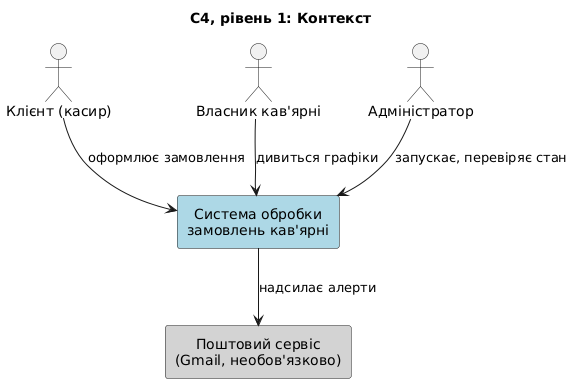

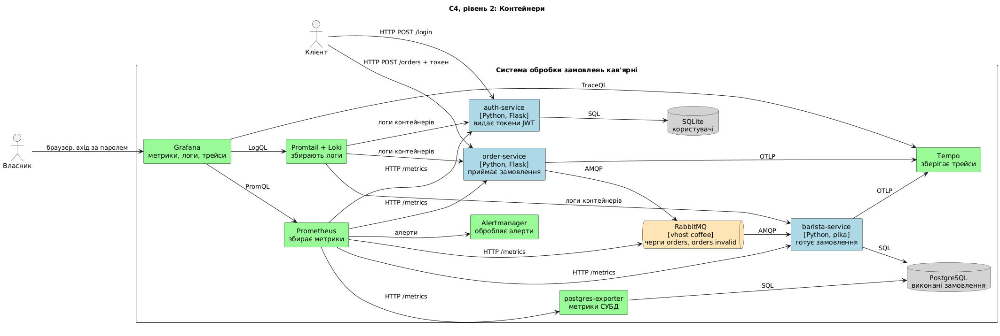

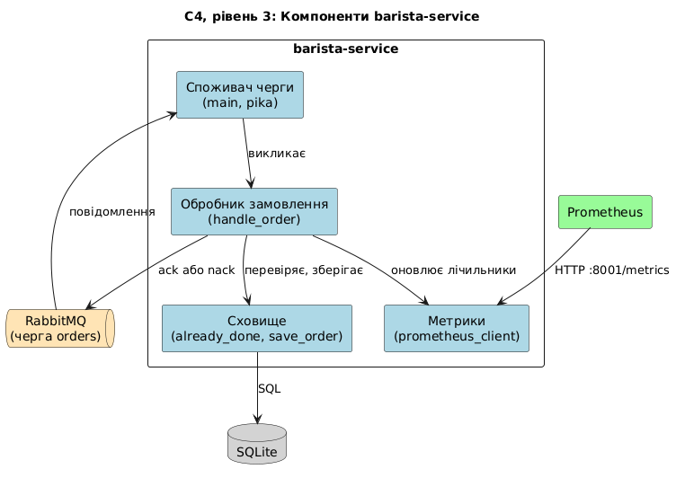

### Діаграми IDEF0

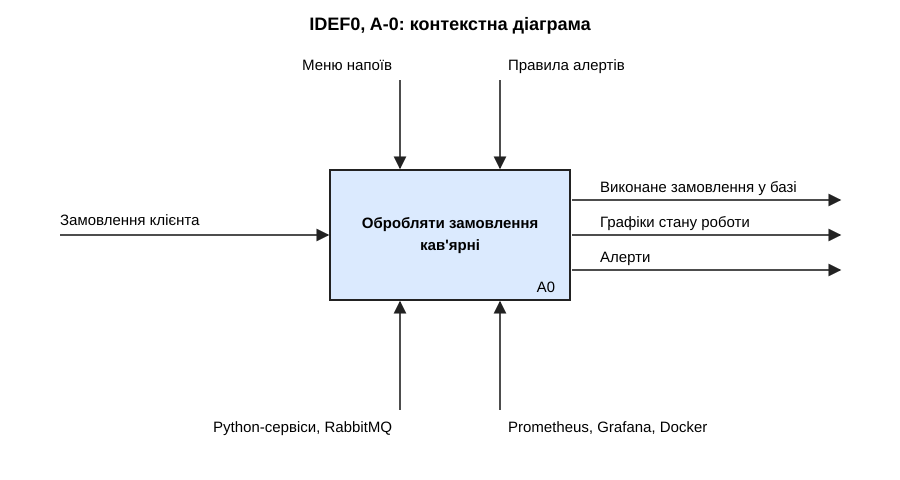

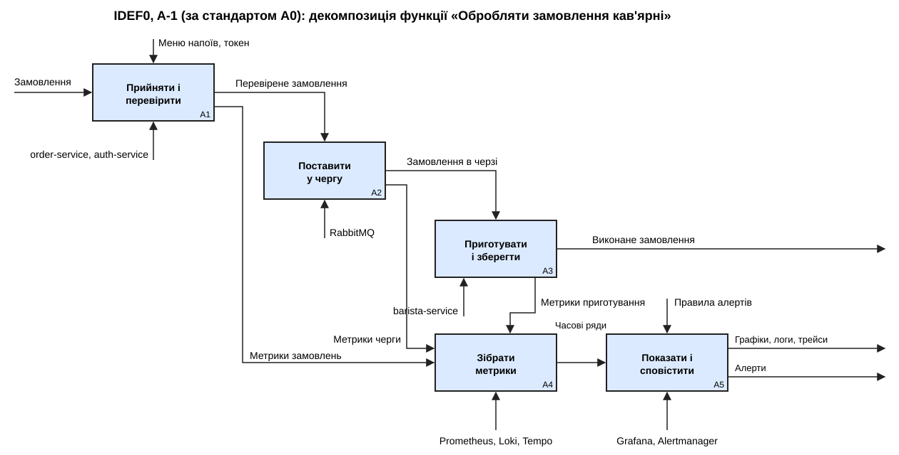

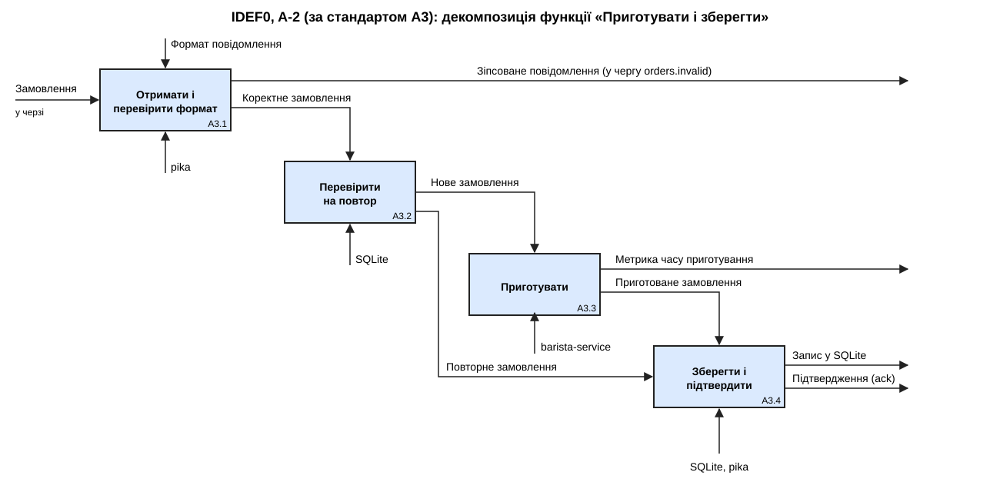

### Як проходить замовлення

1. Користувач отримує токен JWT в auth-service.
2. Клієнт надсилає `POST /orders` із токеном в order-service.
3. order-service перевіряє токен і дані, починає трейс і надсилає подію `OrderCreated` в exchange `coffee`.
4. RabbitMQ направляє подію в чергу `orders`.
5. barista-service бере одне замовлення, готує його та записує в PostgreSQL.
6. Лише після збереження сервіс підтверджує обробку. Зіпсоване повідомлення переходить у чергу `orders.invalid`. Якщо база недоступна, замовлення повертається в чергу.
7. Prometheus кожні 5 секунд збирає метрики, Promtail передає логи в Loki, трейси надходять у Tempo. Grafana показує всі ці дані, а Alertmanager обробляє алерти.

### Класифікація архітектурних рішень

| Вид архітектури | Рішення |
|---|---|
| Бізнес-архітектура | увійти, прийняти замовлення, поставити в чергу, приготувати, контролювати |
| Інформаційна | події `OrderCreated`, база PostgreSQL, база користувачів SQLite, часові ряди метрик, логи, трейси |
| Прикладна | auth-service, order-service, barista-service, RabbitMQ, Prometheus, Loki, Tempo, Grafana, Alertmanager |
| Технічна | Docker, Docker Compose, Python, засоби моніторингу та розмежування прав |

### Основні рішення

| Рішення | Причина |
|---|---|
| Асинхронний зв'язок через брокер | прийом замовлень не залежить від швидкості бариста |
| Підтвердження після збереження | замовлення не загубиться при збої сервісу |
| Перевірка `id` перед обробкою | RabbitMQ може доставити повідомлення повторно |
| Durable-черга та persistent-повідомлення | замовлення переживають перезапуск брокера |
| Окремий virtual host і облікові записи | мінімальні права для кожного сервісу |
| Черга `orders.invalid` | зіпсовані повідомлення доступні для аналізу |
| PostgreSQL в окремому контейнері | клієнт-серверна СУБД, яку вимагає завдання |
| Сервер авторизації з токенами JWT | доступ лише для авторизованих користувачів |
| Передача контексту трейса в повідомленні | трейс не обривається на брокері |
| Повернення замовлення в чергу при помилці БД | замовлення виконається, коли база запрацює |

## 5. Обґрунтування технологій

| Компонент | Технологія |
|---|---|
| Сервіси | Python, Flask, pika, psycopg |
| Брокер | RabbitMQ |
| База даних | PostgreSQL |
| Авторизація | Python, SQLite, JWT |
| Метрики й алерти | Prometheus, postgres-exporter, Alertmanager |
| Логи | Grafana Loki, Promtail |
| Трейси | Grafana Tempo, OpenTelemetry |
| Візуалізація | Grafana |
| Запуск | Docker, Docker Compose |

RabbitMQ обрано замість Kafka, бо потрібна черга завдань: кожне замовлення виконує один бариста, а після виконання повідомлення більше не потрібне. Kafka краще підходить для потоку подій, які читають багато споживачів.

## 6. Реалізація

**auth-service** зберігає користувачів у SQLite, паролі лише у вигляді хешу. Сервіс видає підписаний токен JWT на 60 хвилин, а нових користувачів може реєструвати лише адміністратор.

**order-service** перевіряє токен, приймає замовлення через HTTP, перевіряє напій, кількість та ім'я клієнта, передає подію в RabbitMQ і чекає підтвердження від брокера. Якщо брокер недоступний, клієнт отримує помилку 503.

**barista-service** бере замовлення по одному, перевіряє формат і повторність, імітує приготування, записує результат у PostgreSQL та підтверджує обробку. Якщо RabbitMQ або PostgreSQL недоступні, сервіс повторює підключення, а необроблені замовлення чекають у черзі.

**RabbitMQ** налаштовано файлом `rabbitmq/definitions.json`: окремий virtual host, три користувачі з різними правами, exchange, черги та зв'язки.

**Моніторинг.** Сервіси віддають метрики на `/metrics`, а `postgres-exporter` надає метрики роботи СУБД: стан, з'єднання, транзакції, вставлені рядки й розмір бази. Правила спрацьовують на довгу чергу, зіпсовані повідомлення та зупинку будь-якого сервісу чи СУБД.

**Логи.** Promtail збирає журнали контейнерів і передає їх у Loki. Рядки містять `trace_id`, тому з журналу можна перейти до трейса.

**Трейси.** OpenTelemetry створює один трейс на замовлення: `POST /orders`, `rabbitmq publish`, `process order`, `prepare drink`, `postgres insert`. Контекст передається через заголовки повідомлення RabbitMQ.

Повний опис інтерфейсів наведено в `06-контракт-сервісів.md`.

## 7. Інструкція користувача

Потрібен запущений Docker Desktop.

Запуск системи (у папці проєкту):

```
docker compose up -d --build
```

Надсилання тестових замовлень:

```
powershell -ExecutionPolicy Bypass -File scripts\send-orders.ps1 -Count 20 -DelayMs 500
```

Скрипт сам входить у систему як `cashier`.

| Що | Адреса | Вхід |
|---|---|---|
| Grafana: метрики, логи, трейси | http://localhost:3000 | `admin` / `coffee_grafana` |
| RabbitMQ | http://localhost:15672 | `coffee` / `coffee_pass` |
| Prometheus | http://localhost:9090 | без пароля |
| Alertmanager | http://localhost:9093 | без пароля |

Перегляд виконаних замовлень:

```
docker compose exec barista-service python show_orders.py
```

Зупинка системи:

```
docker compose down
```

## 8. Тестування

Проведено 37 тестів. Висхідне тестування перевіряло окремі сервіси, інтеграційне їхню взаємодію. Усі тести пройдено. Повна таблиця наведена в `03-тестування.md`.

| Група | Що перевірено | Результат |
|---|---|---|
| Авторизація | вхід, підроблені токени, реєстрація, ролі, вхід у Grafana | пройдено |
| Прийом замовлень | правильні дані, неправильні типи, межі значень, 100 паралельних запитів | пройдено |
| Основний ланцюжок | від замовлення до запису в PostgreSQL | пройдено |
| Моніторинг БД і сервісів | метрики PostgreSQL, дашборд, значення після перезапусків | пройдено |
| Логи і трейси | логи п'яти сервісів у Loki, трейс із 5 кроків у Tempo | пройдено |
| Алерти | спрацювання і зникнення, час реакції 34–44 секунди, листи на локальному поштовому сервері | пройдено |
| Відмовостійкість | зупинка бариста, аварійне завершення, зупинка RabbitMQ, PostgreSQL та auth-service | пройдено |
| Коректність даних | повторна доставка, зіпсовані повідомлення, неправильні типи | пройдено |
| Безпека | окремий virtual host, мінімальні права, заборона `guest`, локальні порти | пройдено |

**Обмеження.** Навантажувальне тестування не проводилось. Надсилання листа через обліковий запис Gmail не перевірялось, бо потребує пароля застосунку.

### Результати роботи

Знімки екрана зроблено 10 листопада 2026 року під час роботи системи на локальному комп'ютері. Рис. 3, 5, 6 і 7 зроблено під час демонстрації збою, коли barista-service було зупинено.

**Рис. 1. Запущені сервіси (`docker compose ps`)**

```
SERVICE             STATUS                    PORTS
alertmanager        Up 14 minutes             127.0.0.1:9093->9093/tcp
auth-service        Up 14 minutes             127.0.0.1:8002->8002/tcp
barista-service     Up 2 minutes              127.0.0.1:8001->8001/tcp
grafana             Up 14 minutes             127.0.0.1:3000->3000/tcp
loki                Up 14 minutes             127.0.0.1:3100->3100/tcp
order-service       Up 14 minutes             127.0.0.1:8000->8000/tcp
postgres            Up 14 minutes (healthy)   5432/tcp
postgres-exporter   Up 14 minutes             9187/tcp
prometheus          Up 14 minutes             127.0.0.1:9090->9090/tcp
promtail            Up 14 minutes             
rabbitmq            Up 14 minutes (healthy)   127.0.0.1:15672->15672/tcp
tempo               Up 14 minutes             127.0.0.1:3200->3200/tcp
```

**Рис. 2. Цілі Prometheus у стані UP**

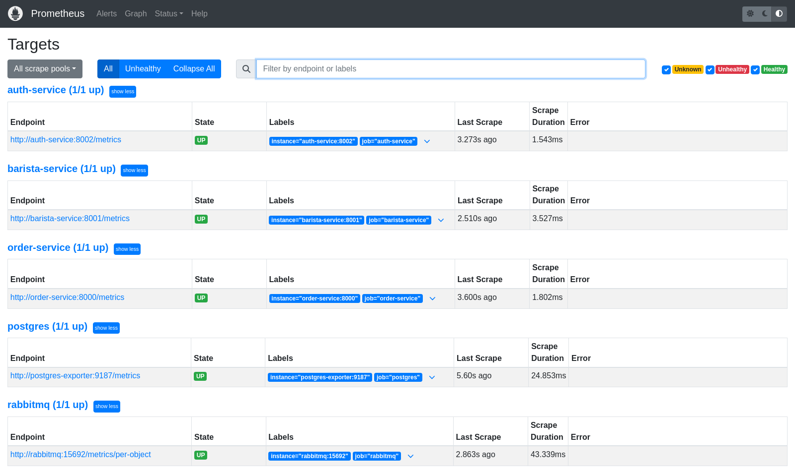

**Рис. 3. Черга `orders` із повідомленнями, коли бариста зупинений**

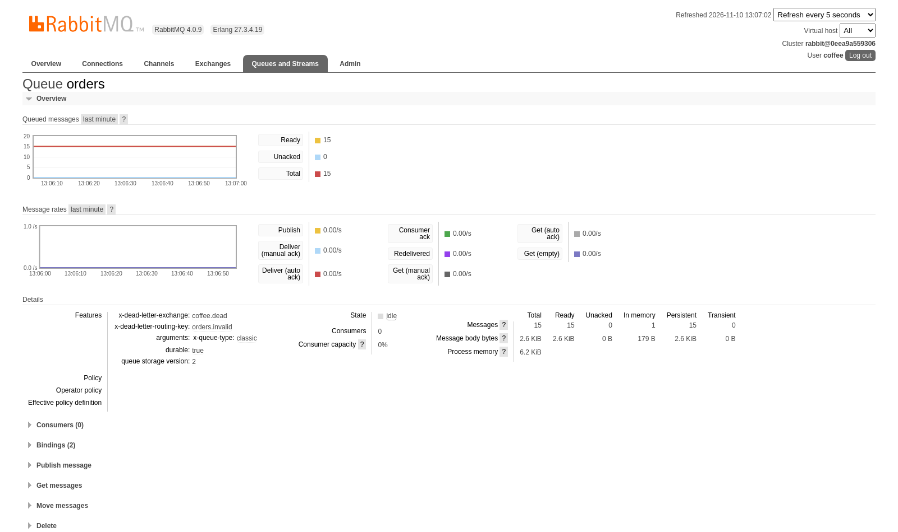

**Рис. 4. Сторінка Admin у RabbitMQ: користувачі та virtual host `coffee`**

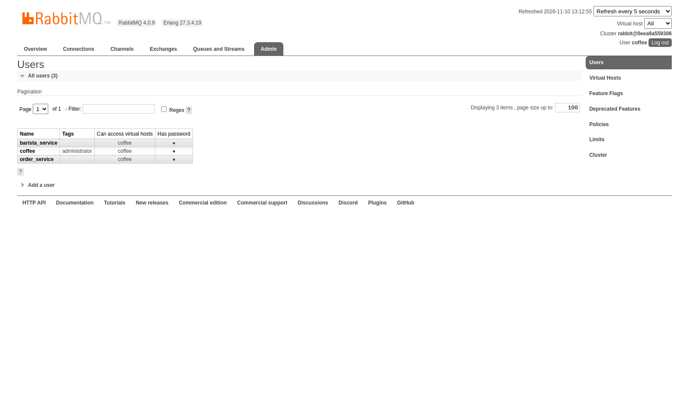

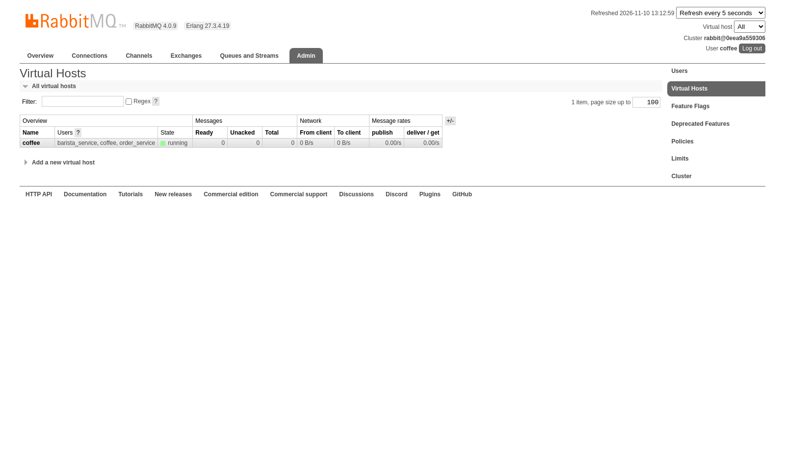

**Рис. 5. Дашборд Grafana під час демонстрації, видно зростання черги**

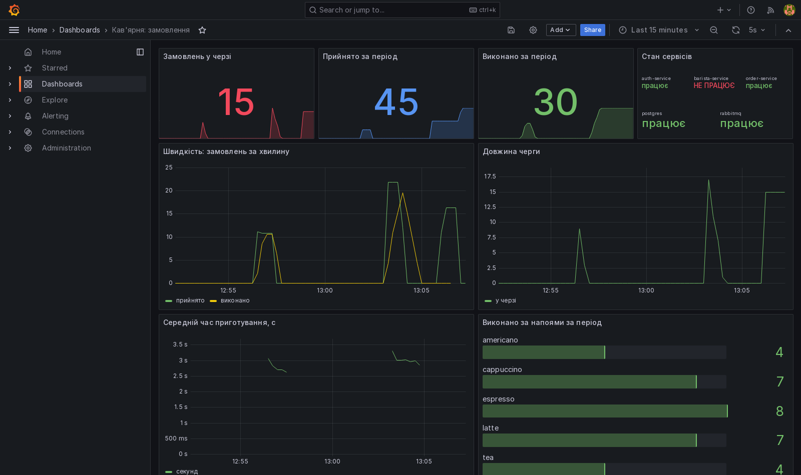

**Рис. 6. Алерти у стані FIRING у Prometheus**

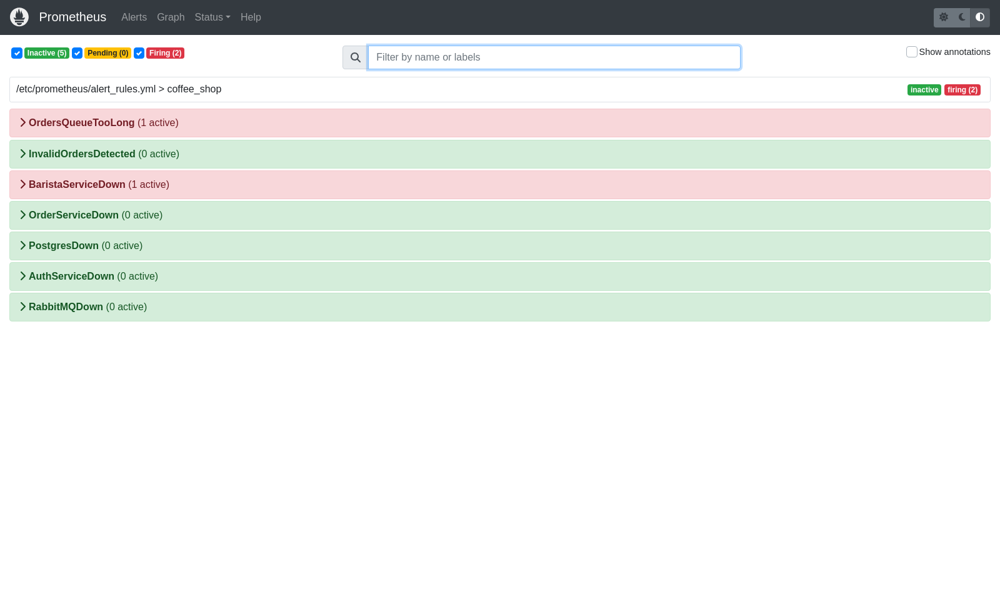

**Рис. 7. Активні алерти в Alertmanager**

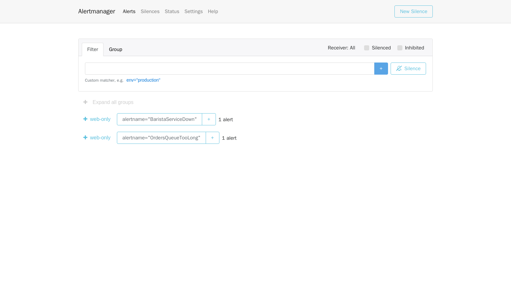

**Рис. 8. Виконані замовлення в PostgreSQL (`show_orders.py`)**

```
Усього виконано: 55
2026-11-10T13:08:17+00:00  cappuccino   x2  client-15
2026-11-10T13:08:14+00:00  cappuccino   x2  client-14
2026-11-10T13:08:11+00:00  latte        x2  client-13
2026-11-10T13:08:07+00:00  tea          x3  client-12
2026-11-10T13:08:04+00:00  cappuccino   x3  client-11
2026-11-10T13:08:00+00:00  latte        x1  client-10
2026-11-10T13:07:56+00:00  tea          x2  client-9
2026-11-10T13:07:54+00:00  tea          x2  client-8
2026-11-10T13:07:52+00:00  tea          x2  client-7
2026-11-10T13:07:48+00:00  tea          x1  client-6
2026-11-10T13:07:45+00:00  latte        x2  client-5
2026-11-10T13:07:42+00:00  espresso     x3  client-4
```

**Рис. 9. Відповідь 401 на запит до API без токена**

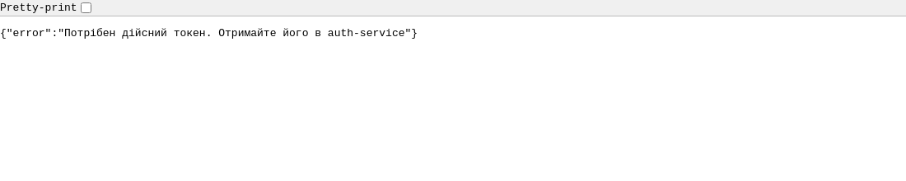

**Рис. 10. Панелі роботи PostgreSQL на дашборді**

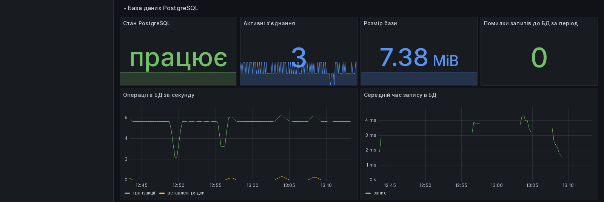

**Рис. 11. Логи сервісів у Grafana (Loki)**

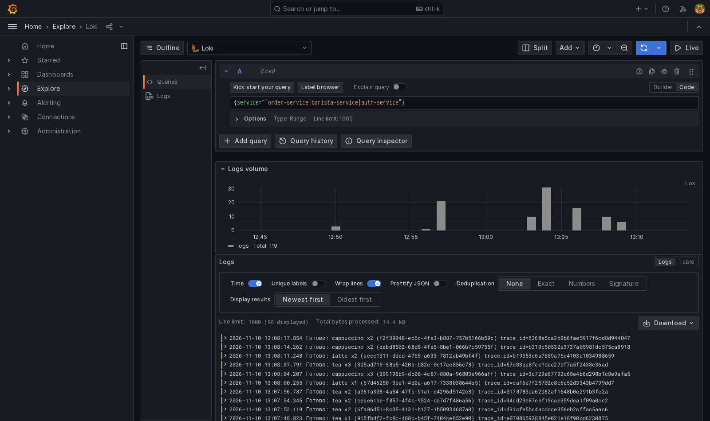

**Рис. 12. Трейс замовлення у Grafana (Tempo)**

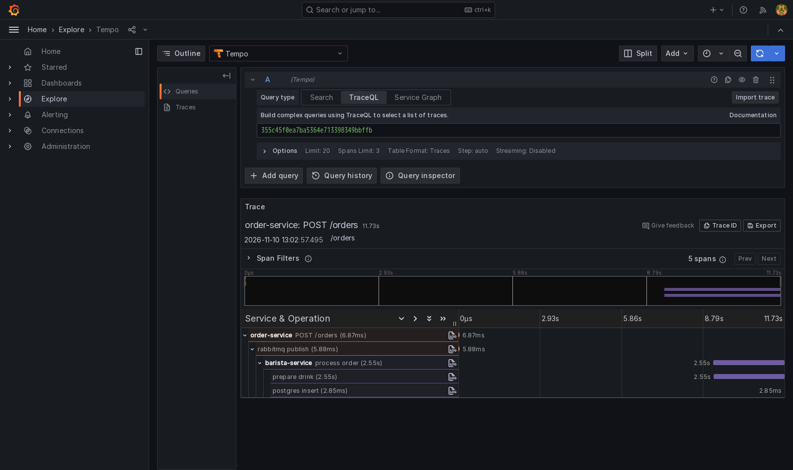

## 9. Висновки

У роботі спроєктовано та реалізовано інформаційну систему обробки замовлень кав'ярні, яка записує дані в PostgreSQL і забезпечує спостереження за роботою бази даних та сервісів. Доступ до системи контролює сервер авторизації.

Застосування брокера повідомлень RabbitMQ дало змогу приймати замовлення незалежно від стану сервісу приготування та бази даних. Ручне підтвердження та збереження повідомлень запобігають втраті замовлень під час збоїв, а перевірка ідентифікатора унеможливлює повторну обробку.

Поєднання метрик Prometheus, логів Loki та трейсів Tempo в Grafana дає повну картину роботи системи: метрики показують наявність проблеми, логи пояснюють її причину, а трейс показує шлях конкретного замовлення. Система реагує на збої менш ніж за хвилину. Тестування підтвердило виконання функціональних і нефункціональних вимог.

Подальший розвиток системи може включати збереження подій на час недоступності брокера, авторизацію в Grafana через єдиний сервер входу та масштабування сервісу приготування.
